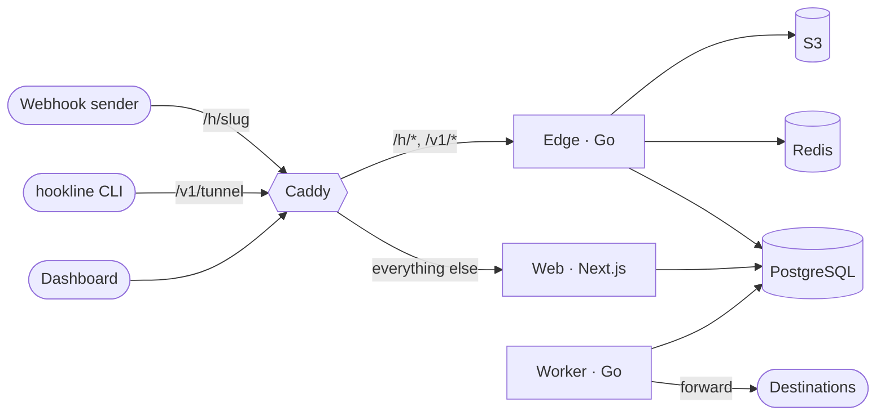

# Hookline

**Catch every webhook. Replay anything. Pipe it to localhost.**

Hookline gives you a URL that captures any HTTP request, shows it live, lets you inspect, replay and forward it, and pipes it to localhost through a CLI tunnel. It is free software under the GNU General Public License v3.0: use the hosted service or run the whole stack yourself.

```sh
hookline listen k3Jx9QpL2mWa --forward http://localhost:3000/api/webhooks
✓ Forwarding https://hooks.example.com/h/k3Jx9QpL2mWa → http://localhost:3000/api/webhooks
12:04:31  POST /h/k3Jx9QpL2mWa/stripe  → 200  38 ms  payment_intent.succeeded
12:05:02  POST /h/k3Jx9QpL2mWa/github  → 500  112 ms  push
```

## Features

- **Capture.** Every method on any sub-path, with headers, query, body, source and timing. Custom responses, delays and temporary endpoints that need no account.
- **Live inbox.** Requests appear within about 100 ms and the stream resumes after a disconnect. Filters, full-text search, keyboard shortcuts, and JSON, form, XML, raw and hex views. Sensitive headers are masked until revealed, and every reveal is audited.
- **Replay.** Send any request again to a destination, to the CLI or to any URL, as captured or after editing it.
- **Forward.** Destinations with method, header and JSON-path filters, durable retries with backoff, a full attempt log and optional Standard Webhooks signing. Forwarding never reaches private networks.
- **Tunnel.** `hookline listen` forwards to localhost, and sync mode returns your server's answer to the sender.
- **Verify.** Signature checks for Stripe, GitHub, Shopify, Slack, Standard Webhooks, Discord and generic HMAC-SHA256, run when the request is captured.
- **Teams and API.** Organizations with roles, invitations and an audit log; passkeys and TOTP; a REST API described by OpenAPI, with scoped keys, idempotency and rate limits.
- **Operate.** Plans and usage limits, optional Stripe billing, a status page, an admin area, Docker images and one-command self-hosting.

## Install the CLI

```sh
brew install --cask kaanxsrd/tap/hookline       # macOS
scoop bucket add hookline https://github.com/kaanxsrd/scoop-bucket
scoop install hookline                           # Windows
npm install -g hookline-cli                     # anywhere with Node 18+
```

Archives for macOS, Linux and Windows are on the [releases page](https://github.com/kaanxsrd/hookline/releases). Then run `hookline login`, and see the [CLI guide](apps/web/app/docs/%28guides%29/cli/page.mdx) (served at `/docs/cli`) for everything else.

## Self-host

On a host with Docker, ports 80 and 443 open and a DNS record pointing at it:

```sh
git clone https://github.com/kaanxsrd/hookline && cd hookline
cp deploy/production.env.example .env.production   # domain, secrets, SMTP
docker compose -f docker-compose.prod.yml --env-file .env.production up -d
```

That starts Caddy with automatic TLS, the web app, the edge, the worker, PostgreSQL, Redis, MinIO and daily database backups, and runs migrations first. [`docs/deployment.md`](docs/deployment.md) covers the first administrator, backups and restores, upgrades, Fly.io, email, Stripe and load testing.

## How it works



The **edge** captures requests, streams them to open inboxes and runs CLI tunnels. The **worker** forwards, retries, replays and enforces retention. The **web app** serves the dashboard, docs and REST API. PostgreSQL holds everything durable, including the job queue. Redis is a cache and pub/sub bus that the edge can run without. Large bodies go to S3-compatible storage. Read more in [`docs/architecture.md`](docs/architecture.md) and [`docs/tunnel-protocol.md`](docs/tunnel-protocol.md).

## Develop

Requirements: [Bun](https://bun.sh) 1.3+, [Go](https://go.dev/dl/) 1.27+ and Docker.

```sh
cp .env.example .env
docker compose up -d     # Postgres, Redis, MinIO (+ bucket), Mailpit
bun install
bun run db:migrate
bun run db:seed          # demo org; sign in as admin@hookline.local / hookline-dev-password
bun run dev              # web :3000, edge :8080, worker :8081
```

The first `bun run dev` or `bun run check` also builds the pinned Go tools (air, golangci-lint, govulncheck) into `.tools/bin`, which takes a minute or two. The seeded admin account can open `/admin`.

| URL                           | What                  |
| ----------------------------- | --------------------- |
| http://localhost:3000         | Web app               |
| http://localhost:8080/healthz | Edge server           |
| http://localhost:8081/healthz | Worker                |
| http://localhost:8025         | Mailpit (local email) |
| http://localhost:9001         | MinIO console         |

### Scripts

| Command               | What it does                                                          |
| --------------------- | --------------------------------------------------------------------- |
| `bun run dev`         | Runs every service with hot reload (Next.js and air)                  |
| `bun run check`       | Biome, tsc, golangci-lint and all unit tests                          |
| `bun run test:e2e`    | Playwright end-to-end tests against the local stack                   |
| `bun run build`       | Production build                                                      |
| `bun run check:fix`   | Applies Biome fixes                                                   |
| `bun run db:migrate`  | Applies database migrations                                           |
| `bun run db:seed`     | Loads demo data (safe to re-run)                                      |
| `bun run db:generate` | Generates a migration from schema changes                             |
| `bun run db:studio`   | Opens Drizzle Studio                                                  |
| `bun run gen`         | Regenerates the API types, entitlements, mail templates and sqlc code |
| `bun run admin:grant` | Makes an account an instance administrator                            |
| `bun run loadtest`    | Load-tests an intake URL and reports latency percentiles              |
| `bun run vulncheck`   | govulncheck on every Go module and `bun audit`                        |

### Repository layout

```
apps/web           Next.js: marketing site, docs, auth, dashboard, admin, REST API
services/edge      Go: webhook intake, SSE streams, CLI tunnels
services/worker    Go: forwarding, retries, retention, rollups, notifications
cli                Go: the hookline CLI (cli/npm: the npm launcher)
packages/db        Drizzle schema, migrations and seed (the only owner of the schema)
packages/gocommon  Go: config, logging, HTTP plumbing, sqlc queries shared by the Go services
packages/protocol  Go: the CLI tunnel protocol
packages/shared    TypeScript: API types, entitlements and helpers shared across packages
api/openapi.yaml   The REST API contract
config/plans.json  Plan limits (source of the generated Go and TypeScript entitlements)
deploy             Caddyfile, production env template and Fly.io configurations
tools              Pinned Go developer tools (outside go.work)
scripts            Repository scripts (Bun): code generation, load testing, release packaging
docs               Architecture, tunnel protocol, deployment and implementation status
```

## Contributing and security

Read [`CONTRIBUTING.md`](CONTRIBUTING.md) for conventions, database changes, tests and releases. Please report vulnerabilities privately as described in [`SECURITY.md`](SECURITY.md).

## License

[GNU General Public License v3.0](LICENSE). Hookline is free software: you can redistribute and modify it under the terms of the GPL, version 3. It comes with no warranty.
