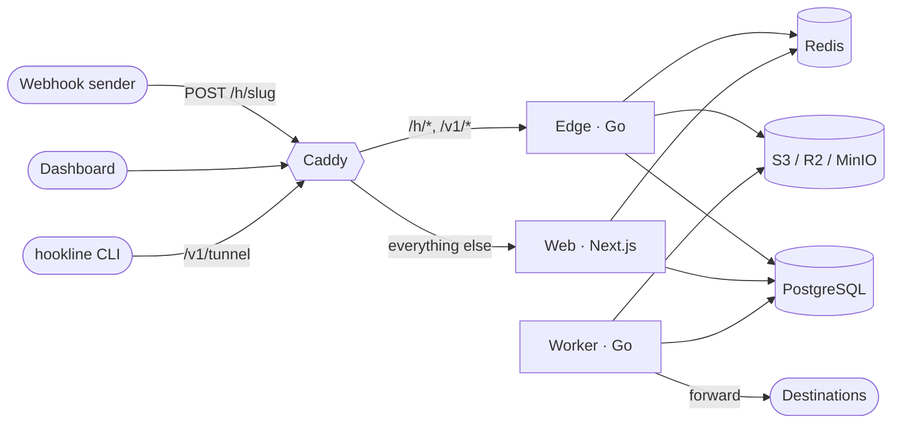

# Architecture

Hookline is three processes and three stores behind one domain.

| Process                        | Responsibility                                                                                                         |
| ------------------------------ | ---------------------------------------------------------------------------------------------------------------------- |
| **edge** (`services/edge`)     | Webhook intake on `/h/*`, live SSE streams, CLI tunnels, `/healthz`, `/readyz`; Prometheus on a separate internal port |
| **worker** (`services/worker`) | River jobs: forwarding with retries, replays, partition maintenance, retention, usage rollups                          |
| **web** (`apps/web`)           | Marketing site, docs, auth, dashboard, tRPC and the public REST API                                                    |

| Store                     | Holds                                                                                                                    |
| ------------------------- | ------------------------------------------------------------------------------------------------------------------------ |
| **PostgreSQL 17**         | Everything durable, including the River job queue. The schema lives in `packages/db` (Drizzle); Go reads it through sqlc |
| **Redis 7**               | Endpoint cache, rate-limit buckets, live fan-out, tunnel routing. Never the system of record                             |
| **S3-compatible storage** | Request bodies over 64 KiB                                                                                               |

All hosts and ports come from the environment (`APP_URL`, `EDGE_PUBLIC_URL`, ...); none are hard-coded.

## Request lifecycle

What happens when a sender calls `ANY /h/{slug}[/*]` (`services/edge/internal/intake`):

1. **Request ID.** Middleware assigns a UUIDv7, returns it as `X-Hookline-Request-Id`, and the same value becomes the request's primary key.
2. **CORS preflight** (`OPTIONS` with `Origin` and `Access-Control-Request-Method`) is answered with `204` and not captured. Every other method, `HEAD` and `OPTIONS` included, is captured.
3. **Resolve the endpoint.** The slug must be 12 base62 characters before anything is looked up. The endpoint comes from Redis (`hl:ep:{slug}`, 60 s) or PostgreSQL; unknown slugs are cached as misses for 10 s. The web app deletes the key when settings change.
4. **Status.** Unknown slug → `404 not_found`. Paused → `410 endpoint_paused`. Disabled by an administrator → `410 endpoint_disabled`. Expired anonymous endpoint → `410 endpoint_expired`.
5. **Rate limit.** One Redis Lua script checks two token buckets, the endpoint's (rate and burst from the owner's plan) and the source IP's (instance-wide), taking a token only when both allow. Server time (`TIME`) keeps instances consistent. Rejections get `429 rate_limited` with `Retry-After`.
6. **Quota.** Anonymous endpoints accept at most 100 requests (`429 quota_exceeded`). Monthly quotas for organizations arrive with usage tracking.
7. **Body.** The plan's cap is enforced from `Content-Length` and again while streaming (`http.MaxBytesReader`) → `413 body_too_large`. Bodies up to 64 KiB are stored inline; larger ones are uploaded to object storage first under `{org|anonymous}/{endpoint}/{yyyy}/{mm}/{dd}/{requestId}`.
8. **Insert.** One row in the partitioned `request` table. If the day's partition is missing, the edge creates it (`hookline_ensure_request_partitions`) and retries once.
9. **Announce.** A request summary (no header values, no body) is published on `ep:{endpointId}`. Endpoint counters are batched in memory and flushed every second rather than updated per request, which would serialize intake on a row lock.
10. **Respond** with the endpoint's configured status, headers and body after its optional delay.

### Response hardening

Intake responses are served from the application's own origin, and their content is chosen by whoever configures the endpoint. Every intake response therefore carries:

- `Content-Security-Policy: sandbox; default-src 'none'; frame-ancestors 'none'`: any HTML runs in an opaque, script-less origin and can never act as the dashboard.
- `X-Content-Type-Options: nosniff`, `X-Frame-Options: DENY`, `Referrer-Policy: no-referrer`.
- `Access-Control-Allow-Origin: *` (intake only), exposing `X-Hookline-Request-Id`.

Configured responses cannot set cookies, security policies, CORS, framing, hop-by-hop or `X-Hookline-*` headers.

### Header fidelity

Headers are stored as an ordered array of `[name, value]` pairs, with repeated values kept in their original order. Go's HTTP server canonicalizes header names and does not preserve their order, HTTP/2 lowercases them, and any proxy in front (Caddy) rebuilds them. So the edge stores names in canonical form, sorted, with `Host` first. Original casing and inter-header order are not recoverable once a request has passed through a standard HTTP stack.

## Live stream

Dashboards receive requests live over Server-Sent Events from `GET /v1/stream/{endpointId}?token=...` on the edge (`services/edge/internal/stream`).

1. **Token.** The browser asks the web app for a stream token: the `stream.token` procedure for members, or a server action for anonymous view-token holders. The web app checks access and signs a compact HS256 JWT with `STREAM_TOKEN_SECRET`: five minutes, claims `sub`, `org`, `ep`, `aud=hookline-stream`. The edge accepts exactly HS256 and checks the signature in constant time, the audience, expiry (±30 s skew) and that `ep` matches the URL. The query string never reaches logs.
2. **One subscription per process.** The edge's `Hub` holds a single Redis pub/sub connection. It subscribes to `ep:{id}` when the first local viewer of that endpoint arrives and unsubscribes when the last leaves, then fans messages out in memory. A viewer more than 256 events behind is disconnected rather than slowing the others, and it resumes on reconnect.
3. **Resume.** Event IDs are request IDs (UUIDv7). A reconnect sends `Last-Event-ID` (EventSource's own retry) or `last_event_id` (our client's retry with a fresh token). The edge subscribes first, then replays up to 500 newer requests from PostgreSQL (bounded by the UUID's timestamp minus a minute, so only recent partitions are scanned), then streams live events, skipping any it just replayed. Beyond 500 missed requests it sends `resync` and the page reloads its list.
4. **Events:** `request`, `delivery`, `endpoint`, `ping` every 15 s, `resync`, and `reconnect`, which is sent to every viewer when the edge shuts down (registered with `http.Server.RegisterOnShutdown`) so streams never hold up a deploy.
5. **Client** (`useLiveRequests`). It reconnects with exponential backoff and jitter (1 s up to 30 s), reuses a token while more than a minute remains, drops the stream as soon as the browser reports `offline` and reconnects on `online`, and de-duplicates by request ID.

In development the web app and the edge are different origins; the stream answers with `Access-Control-Allow-Origin` set to `APP_URL`'s origin. The token travels in the query string because `EventSource` cannot send headers.

## Authentication and authorization

- **Better Auth** (`apps/web/lib/auth.ts`) handles email and password with required verification, passkeys (WebAuthn), TOTP two-factor with backup codes, organizations, invitations and email changes. Its tables live in the Drizzle schema with UUIDv7 IDs. Sessions are httpOnly, `SameSite=Lax` cookies (`hookline.session_token`), and Better Auth's origin checks protect against CSRF.
- **Roles:** `viewer < member < admin < owner`, defined once in `apps/web/lib/permissions.ts` and used in two places: by Better Auth's access control for its own organization endpoints, and as ranks by the tRPC middleware.
- **tRPC** (`apps/web/server`): `orgProcedure` resolves the caller's membership from `orgSlug` and answers 404 to non-members, so an organization's existence never leaks. It enforces `meta.role` and writes an audit-log entry for every successful mutation; handlers describe the target with `ctx.audit(...)`. Member and invitation changes go through tRPC, which calls Better Auth server-side, so they are audited with the real actor.
- **Plan limits** are checked where an action happens: endpoint creation and claiming (endpoint count), and invitations (members, through a Better Auth `beforeCreateInvitation` hook).
- **Email:** React Email templates rendered by Nodemailer (Mailpit locally). Messages whose timing could reveal whether an account exists (password resets) are sent without blocking the response.
- **Account safety:** a disabled user cannot create sessions. Deleting an account is refused while the user is the only owner of an organization that has other members; organizations they are alone in are deleted with them.
- **Claiming a temporary endpoint:** the visitor's httpOnly cookie proves ownership. Claiming moves the endpoint and its captured requests into the organization, removes the expiry and view token, and invalidates the edge's cache.
- **Content Security Policy** (`apps/web/proxy.ts`): a per-request nonce with `strict-dynamic` for scripts (the theme script carries the nonce); `style-src 'unsafe-inline'`, because component libraries position elements with inline style attributes; `connect-src` adds the edge origin for SSE in development; `frame-ancestors 'none'`. The proxy also redirects requests without a session cookie to sign-in before rendering; pages still verify the session on the server.

## CLI tunnels

`hookline listen` keeps a WebSocket open to the edge's `/v1/tunnel` and forwards each captured request to a local server; `hookline tail` only prints them. The protocol, routing across instances, sync mode and close codes are specified in [tunnel-protocol.md](tunnel-protocol.md). In short: intake publishes every request on `tunnel:ep:{endpointId}`; whichever edge instance holds a tunnel for that endpoint forwards it; in sync mode intake waits on `tunnel:resp:{requestId}` for the first answer and falls back to the static response.

The CLI signs in with the device flow (RFC 8628): it shows a code, the user approves it at `/cli/authorize` and picks an organization, and the CLI receives an API key once. Keys are `hk_live_` plus 43 base62 characters; only their SHA-256 hash and an 8-character prefix are stored. The edge checks keys itself (`services/edge/internal/apikey`); the web app checks them for `/api/v1`.

## Forwarding

1. **Enqueue.** When intake stores a request it evaluates each enabled destination's filter (`gocommon/destfilter`) and, in the same transaction, inserts a `delivery` row and a River `deliver` job per match. A crash can never leave a request without its deliveries, or a job without its row. Manual retries and tests from the web app insert their rows and jobs in one transaction too, using River's own insert and `LISTEN/NOTIFY` wake-up (`apps/web/lib/jobs.ts`).
2. **Deliver** (`services/worker/internal/deliver`). The worker loads the delivery, its destination and the request (body from PostgreSQL or S3), and sends it through `gocommon/safehttp`: every resolved address is checked at dial time, so DNS rebinding cannot reach internal networks; redirects are not followed and environment proxies are ignored. Each attempt is stored in `delivery_attempt`.
3. **Retry.** Retryable outcomes (network errors, timeouts, 408, 429, 5xx) snooze the River job with full-jitter exponential backoff (10 s × 2ⁿ, at most 6 h) or the server's `Retry-After`; the delivery's own attempt counter, not River's, decides when to give up. Other client errors fail immediately.
4. **Announce.** Each status change is published on `ep:{endpointId}` as a `delivery` event, which the edge fans out to open inboxes.
5. **Maintenance.** The same River client runs periodic jobs on its elected leader only, so any number of worker processes can run.

Signing secrets for Standard Webhooks are stored as AES-256-GCM envelopes (`hlenc:v1:<kid>:…`) under `DATA_ENCRYPTION_KEY`, with the destination ID as associated data so an envelope cannot be moved to another row. The first key encrypts; older keys keep decrypting, so keys can rotate.

## Data model notes

- **IDs** are UUIDv7 everywhere, from a `uuidv7()` SQL default (PostgreSQL 17 has none built in) or from the application when the timestamp must be chosen.
- **`request` is partitioned by day** on `received_at` (UTC), with primary key `(id, received_at)`. The worker keeps partitions 7 days ahead, and retention drops whole partitions. `delivery` references requests by `(request_id, request_received_at)` without a foreign key, so dropping a partition is never blocked.
- **Search** uses a trigram GIN index on `encode(body_inline, 'escape')`, which is immutable and never fails on invalid UTF-8. Queries escape the term the same way.
- **`updated_at`** is maintained by triggers, so Go and TypeScript writers behave identically.

## Failure behaviour

| Failure             | Effect                                                                                                                                                                                                                                        |
| ------------------- | --------------------------------------------------------------------------------------------------------------------------------------------------------------------------------------------------------------------------------------------- |
| Redis down          | Intake keeps working: endpoints load from PostgreSQL, rate limiting fails open, live updates and tunnels degrade. Logged once per 10 s and counted in `hookline_edge_degraded_operations_total`. `/readyz` reports `degraded` with status 200 |
| Object storage down | Bodies over 64 KiB get `503 storage_unavailable`; smaller ones are still captured                                                                                                                                                             |
| PostgreSQL down     | Intake answers `503 unavailable`; `/readyz` answers 503 so the instance leaves rotation                                                                                                                                                       |
| Worker down         | Jobs wait in PostgreSQL; nothing is lost                                                                                                                                                                                                      |
| Shutdown            | Servers stop accepting, drain in-flight requests (`EDGE_SHUTDOWN_TIMEOUT`, default 25 s) and flush endpoint counters                                                                                                                          |

## Observability

- **Logs:** structured JSON (`slog`), one access-log line per request with the request ID, method, path, status, size and duration. Query strings, header values and bodies are never logged.
- **Metrics** (`EDGE_METRICS_ADDR`, default `:9090`): `hookline_intake_duration_seconds{outcome}`, `hookline_intake_body_bytes_total`, `hookline_intake_rejects_total{reason}`, `hookline_intake_offloaded_bodies_total`, `hookline_edge_degraded_operations_total{dependency,operation}`, `hookline_stream_clients`, `hookline_stream_events_total`, plus Go runtime and process metrics.

## Development environment

- `docker compose up -d` provides PostgreSQL, Redis, MinIO (with the bucket created) and Mailpit on 127.0.0.1.
- One root `.env` configures everything. `scripts/go.ts dev` passes it to the Go services. `scripts/with-env.ts` starts Next.js with it, because Next.js only reads `.env` files from its own directory and resets `process.env` before rendering.
- In development the web app (`:3000`) and the edge (`:8080`) are separate origins; `EDGE_PUBLIC_URL` tells the web app where intake lives. In production Caddy serves both from one domain.
- The web app derives client addresses from the rightmost `X-Forwarded-For` hop, which Caddy sets. It must not be exposed without the proxy.
